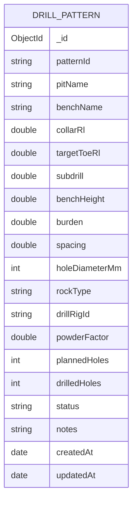

# EDD.md

## Overview

This EDD documents the MongoDB data model for **BenchMark RL**, an open-pit drill pattern and Reduced Level (RL) tracking application built with Next.js and MongoDB.

- Client source of truth: `lib/mongodb.ts`
- Data access source of truth: `db/drill-patterns.ts` (and `db/connection-status.ts` for health checks)
- Validation source of truth: `lib/schemas/drill-pattern.ts` (Zod)
- Application name (connection metadata): `benchmark-rl`

## Entities

### Entity: DrillPattern

Collection: `drill_patterns`

| Field | BSON Type | Required | Constraints / Notes | Description |
| --- | --- | --- | --- | --- |
| `_id` | `ObjectId` | No | Generated by MongoDB | Primary key |
| `patternId` | `string` | Yes | Unique, `minLength: 1` (e.g., `"P-420-014"`) | Site pattern or shot identifier |
| `pitName` | `string` | Yes | `minLength: 1` (e.g., `"North Pit"`) | Pit or mining area name |
| `benchName` | `string` | Yes | `minLength: 1` (e.g., `"420 Bench"`) | Bench identifier |
| `collarRl` | `double` | Yes | Elevation in meters (e.g., `420.5`) | Starting surface elevation (Collar RL) |
| `targetToeRl` | `double` | Yes | Elevation in meters (e.g., `408.5`) | Target floor elevation (Design Toe RL) |
| `subdrill` | `double` | Yes | `>= 0` (meters, e.g., `1.5`) | Subdrill depth below target toe RL |
| `benchHeight` | `double` | Yes | `> 0` (`collarRl - targetToeRl`) | Calculated vertical bench height (m) |
| `burden` | `double` | Yes | `> 0` (meters) | Distance between rows |
| `spacing` | `double` | Yes | `> 0` (meters) | Distance between holes in a row |
| `holeDiameterMm` | `int` | Yes | `> 0` (e.g., `165`, `229`) | Drill bit / hole diameter in mm |
| `rockType` | `string` | Yes | `minLength: 1` (e.g., `"Fresh Basalt"`, `"BIF"`, `"Oxide Waste"`, `"Saprolite"`) | Primary rock type or geological domain |
| `drillRigId` | `string` | No | Optional (e.g., `"DR-04"`, `"PV271-02"`) | Assigned drill rig identifier |
| `powderFactor` | `double` | No | `>= 0` (kg/bcm, e.g., `0.85`) | Target or actual explosive powder factor |
| `plannedHoles` | `int` | Yes | `>= 1` | Total holes designed in pattern |
| `drilledHoles` | `int` | Yes | `>= 0` | Completed holes drilled so far |
| `status` | `string` | Yes | Enum: `"Planned"`, `"Drilling"`, `"Ready to Charge"`, `"Charged"`, `"Fired"` | Current operational stage of the pattern |
| `notes` | `string` | No | Optional | Ground conditions, water, cavity, or survey notes |
| `createdAt` | `date` | Yes | Set on insert | Record creation timestamp |
| `updatedAt` | `date` | Yes | Set on update | Last modified timestamp |

## Mermaid Diagram

